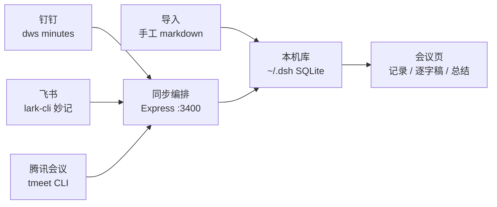
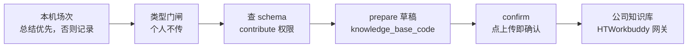

# 会议拉取、入库与交互

本机会议助手（`http://127.0.0.1:3400`）是权威库。钉钉、飞书、腾讯只负责把听记拉进来；公司知识库只接收人点过「上传」的场次，走瀚小智知识库网关，不直连 RAGFlow。

| 听记来源 | 本机服务 | 个人库 | 上传公司知识库 |
|---|---|---|---|
| 3 家 + 导入 | `:3400` | SQLite（`~/.dsh`） | 必须人点一下（opt-in） |

---

## 一、会议拉取技术路线

源侧 CLI 只在同步时调用。落库键是各来源的远程编号（钉钉 `task_uuid`、飞书 `fs:token`、腾讯 `tm:rf:fileId`）。本机删过的 uuid 记入 `deleted_meetings`，下次不同步回来。

钉钉、飞书、腾讯经同步写入本机 SQLite；导入直接入库。界面只读本机库。

| 来源 | CLI / 列表 | 拉什么 | 写回 | 同步节奏 |
|---|---|---|---|---|
| 钉钉 | `dws minutes`：mine + shared | 听记、待办、逐字稿；听记与「会议录制」是不同 `task_uuid` | 标题、记录（有编辑权时） | 自动 30 分钟；手动更新 / 全量 |
| 飞书 | `lark-cli minutes +search`，只按时间窗 | 已有查看权的妙记（自己的 + 别人分享的）；按所有者打 mine / shared | 标题、记录 | 同钉钉；搜索单次最长一个月，按自然月切窗 |
| 腾讯会议 | `tmeet record list`；手动再 `minutes search` | 智能纪要入库；逐字稿打开详情或生成总结时再拉 | 不写回 | 自动至少隔 4 小时、只扫近 3 天；手动更新 / 全量扫 31 天。个人版约 200 次/日 |
| 导入 | 界面选文件 | markdown / 文本，标 `source=import` | 不写回 | 仅手工 |

### 入库后本机做的事

- 增量默认 `skipExisting`：已有场次且已有开会时间的，不覆盖手改过的记录和逐字稿。
- 新场次套分类规则（标题 / 参会人 / 记录命中 → 类型和标签）；手改过类型的不覆盖。
- 记录写入 chunks，供本机语义检索和「问这场会」。向量用本机 `bge-small-zh`。
- 详情三页：记录（来源纪要）、逐字稿、总结（本机 `deep_summary`，不写回来源）。

### 腾讯额度怎么省

- 个人版 CLI 大约每天 200 次业务命令，`auth status` 不占。
- 自动同步不再每 30 分钟扫 31 天、翻页、搜元宝、反复打时长。
- 长会逐字稿按 50 段一页，一场 100 分钟会能吃掉 20+ 次；所以列表阶段只拿智能纪要。
- 点「更新」才扫 31 天并拉元宝纪要。重拉详情仍会拉全文。

> **飞书分享场次**  
> 飞书开放接口没有「分享给我」列表。同步改为每个月时间窗搜一次当前账号已有权看到的妙记；所有者不是登录人则标「飞书·分享」。只发了链接、尚未打开或申请查看权的，搜索仍不会出现。

---

## 二、上传公司知识库技术路线

调用方只传 `knowledge_base_code`，走 HTWorkbuddy `/api/integrations/v1/knowledge/{schema,prepare,confirm,revoke}`。令牌需要 `knowledge:read` / `knowledge:write`。部门会进 `department-management`，不进 `company-general`。

点上传即确认归档：本机场次经类型门闸、查权限、`prepare` 草稿、`confirm` 后进入公司知识库。

| 本机类型 | 知识库代码 | 网关 category | 额外必填 | 敏感级 |
|---|---|---|---|---|
| 个人 | 不上传 | — | — | — |
| 公司管理 | `company-management` | `company_mgmt` | 无 | confidential |
| 公司运营 | `company-operations` | `company_ops` | 无 | internal |
| 项目 | `project` | `project` | `project_code`（精确编号） | internal |
| 部门 | `department-management` | `department_mgmt` | `department_code` + 部门名快照 | internal |

### 正文与元数据

- 上传正文 = 本机总结（`deep_summary`），没有总结才用记录。不传逐字稿。
- Markdown 带会议编号、时间、类别、项目/部门、摘要（总结里的「一句话结论」，最多 300 字）、参会人、待办。
- 网关 metadata 固定 `source_system=meeting_assistant`，`source_record_id=本机 task_uuid`，`doc_kind=meeting`。
- 覆盖同一场：先 `revoke` 旧 `document_uid`，再 `prepare` + `confirm`。幂等键含内容哈希。知识库里已经找不到旧稿时，跳过 `revoke`，直接传新的。

### 门闸（缺一项就停）

- 未选类型、类型为个人、没有总结也没有记录：不能传。
- 项目会没有带编号的项目、部门会没有带编号的部门：不能传。
- 外部系统未填地址/令牌，或 schema 没有 contribute：不能传（常见 403 无权访问该知识库）。
- 本机已有 `company_doc_id` 再点上传：先确认覆盖。撤回走 `revoke`；文档不存在、尚未成功发布或无权撤销时，只取消本机上传标记，然后可以再传。

> **上传不等于检索立即可用**  
> `confirm` 之后网关可能返回 `pending`（后台发布中）或 `awaiting_publication_approval`（等管理员发布）。本机立刻把 `visibility` 标成已入库，并记下 `document_uid`。

---

## 三、功能交互设计

### 信息架构

| 页面 | 人来做什么 | 和数据的关系 |
|---|---|---|
| 会议 | 看列表、更新、问一句、打开一场会整理 | 只读本机库；「更新」触发已登录来源的增量拉取 |
| 待办 | 跨会议跟行动项：完成、改责任人、时限 | 本机 actions；不写回来源侧待办 |
| 设置 | 登录来源、分类规则、称呼表、模型、外部系统、MCP | 写 `~/.dsh` 配置；不改已拉会议正文 |

#### 会议列表

- 顶栏：登录态 · 上次同步；按钮「更新」「导入」。
- 视图：全部 / 待整理 / 已入库。筛选：来源、类型、标签、搜索。
- 每条显示标题、时间、时长、来源标记（钉钉 / 飞书 / 飞书·分享 / 腾讯 / 导入）。
- 问句走本机检索 + 大模型，答案带来源标题，可点进那场会。

#### 一场会的详情

- 头：标题（可改）、来源、时间、参会人、类型/项目/部门/标签、录音（有则本机播放）。
- 三页：记录、逐字稿、总结。记录和总结用 Markdown 编辑器（样式 + 查找替换）；逐字稿是纯文本。
- 工具：编辑、保存、重拉、按规则填写、生成/重新生成总结、上传/撤回、删除本机副本。
- 腾讯没有逐字稿时，打开该页才拉；生成总结若稿为空会先拉再写。

### 关键路径

| 人的动作 | 系统做什么 | 刻意不做的 |
|---|---|---|
| 点更新 | 已登录来源增量拉新会；已在本机的不覆盖手改；删过的不回来 | 不自动上传公司库；腾讯不在这时拉逐字稿 |
| 改标题 / 记录并保存 | 先写本机。钉钉、飞书在写回打开且有权限时同步到来源；分享场次改标题会先确认 | 腾讯和导入只改本机；待办、逐字稿、总结永不写回来源 |
| 生成总结 | 用逐字稿 + 称呼表消歧，写入 `deep_summary` | 不改来源听记；称呼一对多时不猜（但飞书 Speaker N 仍可能被模型映射，需人工看） |
| 点上传 | 校验类型与编号 → 查 contribute → `prepare` → `confirm` → 本机标已入库 | 个人会不上；未选项目/部门编号的项目会、部门会不上 |
| 点撤回 | 网关 `revoke`（已发布稿）并清本机标记；知识库找不到这篇时只清本机标记 | 旧 RAGFlow 直传稿不会自动删 |
| 本机删除 | 只删本地副本，uuid 进删除表 | 来源侧听记不动；公司库已发布稿需另撤回 |

> **设计原则**  
> 本机先完整、公司库再精选。拉取尽量全（在各家 CLI 额度内），上传必须人点一下。来源侧能改的只限标题和记录；决策用的总结、待办、类型、项目留在本机，避免把工作草稿写回听记。
